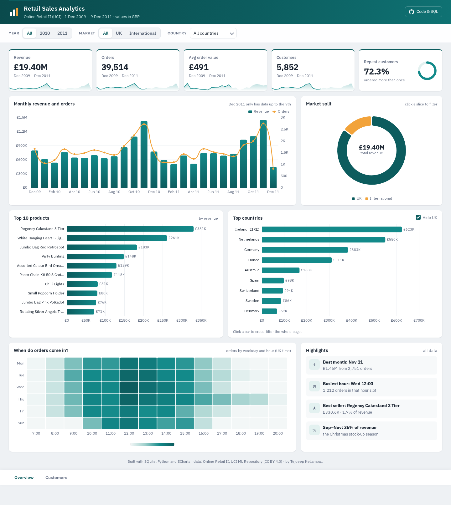

# Retail Sales Analytics (SQL + Python)

Analysis of about 1 million transactions from a UK online gift retailer (Dec 2009 to Dec 2011).
I loaded the raw Excel file into a SQLite database, answered the business questions with SQL,
and built a small Power BI style dashboard that runs on GitHub Pages.

**Live dashboard:** https://tejdeep-67.github.io/retail-sales-analytics/



## Problem

The store sells mostly to wholesalers. With two years of order data I wanted to answer:

- How much do we sell, and how does it move month to month?
- Which products and countries bring in the money?
- Who are the best customers, and who is about to stop buying?
- Do new customers come back?

## Dataset

[Online Retail II](https://archive.ics.uci.edu/dataset/502/online+retail+ii), UCI Machine Learning Repository
(Daqing Chen, 2019), licensed CC BY 4.0. 1,067,371 rows: invoice, product, quantity, price, customer and country.

The data is not stored in this repo. `scripts/download_data.py` downloads it.

## Approach

1. **Cleaning** (`scripts/clean_and_load.py`)
   - removed 34,335 exact duplicate rows
   - moved cancelled invoices (invoice number starts with "C") to a separate `returns` table
   - dropped rows with zero/negative quantity or price, and non-product codes like POSTAGE and BANK CHARGES
   - dropped 2 huge orders (80,995 and 74,215 units) that the customer cancelled straight away
   - left with 1,003,338 clean sale lines
2. **Database** (`sql/schema.sql`): 4 tables, `customers`, `products`, `invoices`, `invoice_items`, plus `returns`.
3. **Analysis in SQL** (`sql/analysis.sql`): KPIs, monthly trend with `LAG()`, top products and countries,
   RFM segmentation with `NTILE()`, cohort retention, Pareto split of customers, and returns per year.
   `scripts/run_queries.py` runs every query and saves the results in `outputs/`.
4. **Dashboard** (`docs/`): GitHub Pages can't run Python, so `scripts/build_dashboard.py` runs the queries for
   every Year x Market slicer combination and saves them to `data.json`. The page draws them with Plotly.

## Results

| KPI | Value |
|---|---|
| Revenue | £19.40M |
| Orders | 39,514 |
| Average order value | £491 |
| Customers | 5,852 |
| Units sold | 11.0M |

What I found:

- **Strong seasonality.** September to November brings in about 38% of the year's revenue. November 2011
  (£1.45M) was almost 3x February 2011 (£0.51M). Stock and staffing should be planned for Q4.
- **Revenue is concentrated.** The top 20% of customers make 76.9% of revenue. The "Champions" RFM segment is
  25% of customers but 69.8% of revenue.
- **829 "At Risk" customers** used to order often (5 orders on average) but have not bought in about a year.
  They spent £1.52M in total, so they are the first group for a win-back offer.
- **72.3% of customers ordered more than once**, but in the monthly cohorts only around 20% are active again
  in any given later month.
- **UK is 85% of revenue.** Ireland (EIRE) is second with £623K from just 3 wholesale accounts.
- **Ordering happens on weekday working hours**, peaking around 12:00. There are almost no orders on Saturdays.
- Cancelled orders were worth about £1.46M over the two years.

RFM segments (from `outputs/rfm_segments.csv`):

| Segment | Customers | Avg orders | Revenue share |
|---|---|---|---|
| Champions | 1,462 | 15.6 | 69.8% |
| Loyal | 1,219 | 5.4 | 14.8% |
| At Risk | 829 | 5.0 | 9.0% |
| Lost / Hibernating | 1,513 | 1.2 | 3.7% |
| New / Promising | 446 | 1.5 | 1.4% |
| Need Attention | 383 | 1.4 | 1.2% |

## Project structure

```
retail-sales-analytics/
├── scripts/
│   ├── download_data.py     # get the dataset from UCI
│   ├── clean_and_load.py    # clean + load into data/retail.db
│   ├── run_queries.py       # run sql/analysis.sql, save outputs/*.csv
│   └── build_dashboard.py   # make docs/data.json for the dashboard
├── sql/
│   ├── schema.sql
│   └── analysis.sql
├── outputs/                 # query results as csv
├── docs/                    # dashboard (GitHub Pages)
└── images/
```

## How to run

```bash
git clone https://github.com/Tejdeep-67/retail-sales-analytics.git
cd retail-sales-analytics
pip install -r requirements.txt

python scripts/download_data.py
python scripts/clean_and_load.py     # takes about a minute, the Excel file is big
python scripts/run_queries.py
python scripts/build_dashboard.py

# view the dashboard locally
cd docs && python -m http.server 8000
# open http://localhost:8000
```

You can also open `data/retail.db` in DB Browser for SQLite and run the queries in `sql/analysis.sql` yourself.

## What I would add next

- Product categories (the data has none, so it would need grouping by keywords in the description)
- A simple forecast of monthly revenue for the next quarter
